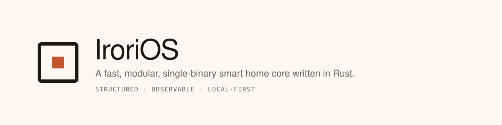

<h1 align="center">
  
</h1>

<p align="center">
  <a href="INSPIRATION.md"><b>Why and what</b></a> ·
  <a href="ROADMAP.md"><b>How and when</b></a> ·
  <a href="docs/specs/entities.md"><b>Entity model</b></a> ·
  <a href="docs/specs/extensions.md"><b>Extensions</b></a> ·
  <a href="dev/README.md"><b>Try it on a Mac</b></a>
</p>

## What it does today

- **Devices:** a registry with live state, and a Devices page that shows everything and switches it.
  Devices come from extensions, such as ESPHome, which finds devices on your network and connects to
  them, sensors and all.
- **Floorplan:** a page that draws the home (walls, doors and windows) with the devices live on it.
- **Automations:** an extension you install. Flows are drawn on a canvas, every run is traced,
  near-misses are kept, and you get dry runs and a 24-hour backtest
  ([flows](docs/specs/flows.md)).
- **People and rooms:** the first run asks who you are, with a password that locks the home to
  you, and the home's time zone ([config §3.10](docs/specs/config.md)). Give a person only some
  rooms and the rest of the home doesn't exist for them, on every page and address. A regular user
  can write automations that stay inside their rooms, and an owner-only activity log records every
  change and every refusal ([access](docs/specs/access.md)).
- **API and command line:** other programs use scoped tokens, and the page hears changes over
  `/api/ws` ([API](docs/specs/api.md)). The same binary talks to a running Irori
  ([CLI](docs/specs/cli.md)).

## Install

```sh
curl -fsSL https://github.com/nicosandller/irori_os/releases/latest/download/install.sh | bash
```

The installer picks the [release](https://github.com/nicosandller/irori_os/releases) for your OS
and CPU, checks its SHA-256 against the release's `SHA256SUMS`, installs `irori` in
`~/.irori/bin` and adds that folder to your shell config. Open a new shell to pick it up.
Releases are built for `linux-x64` and `linux-arm64` (both static musl), `darwin-x64` and
`darwin-arm64`.

Options go after `bash -s --`:

```sh
url=https://github.com/nicosandller/irori_os/releases/latest/download/install.sh
curl -fsSL "$url" | bash -s -- --version 0.2.0    # a specific release
curl -fsSL "$url" | bash -s -- --system           # /usr/local/bin (needs root)
curl -fsSL "$url" | bash -s -- --binary ./target/release/irori   # a local build
```

`releases/latest` skips pre-releases (tags with a `-`, such as `0.3.0-beta.1`); install those
with `--version`. For a `--system` install, [install/irori.service](install/irori.service) is a
systemd unit that runs Irori as an unprivileged `irori` user with its data in `/var/lib/irori`.
`irori uninstall` removes what the installer put down, and leaves a development binary where it
is.

## First run

```sh
irori run                                  # http://127.0.0.1:8480
```

Open the page. The welcome asks who you are and for a password; from then on Irori asks who is
there before it shows anything. Until that owner is set up the home is open, so Irori listens
only on `127.0.0.1` unless you pass `--allow-unauthenticated-lan` (for example to reach it from
your phone). Add `--tls` to serve https so the password travels encrypted: Irori makes its own
certificate the first time (your browser asks about it once), or uses `tls/cert.pem` and
`tls/key.pem` from the data directory.

## Running it

```sh
irori run --log-level debug                # log every device and state change
irori run --config ~/.config/irori         # rooms, names, keys and irori.toml (default ./config)
irori run --data /var/lib/irori            # where the database lives (default ./data)
irori run --bind 0.0.0.0:8480 --allow-unauthenticated-lan
irori version                              # irori 0.7.0-dev (359d176), built 2026-09-16 07:30 UTC
irori help run                             # every option, its environment variable and default
```

`run` and `serve` are the same command. Every option is also an environment variable
(`IRORI_DATA`, `IRORI_CONFIG`, `IRORI_BIND`, `IRORI_BIND_FALLBACK`, `IRORI_LOG_LEVEL`,
`IRORI_ALLOW_UNAUTHENTICATED_LAN`), and most can also go in `irori.toml` in the config directory
([config §3.5](docs/specs/config.md)). A flag wins over the file:

```toml
[server]
bind = "127.0.0.1:8480"
bind_fallback = "127.0.0.1:8481"   # optional; only used when bind is taken
log_level = "info"

[extensions]
disabled = ["demo"]          # applies while Irori runs; [server] needs a restart
```

If the port is taken, Irori uses `--bind-fallback` (`bind_fallback`), or else the next free port
above it, and logs where. A deployment with a fixed, health-checked port (such as a container) should set
`IRORI_BIND_FALLBACK` equal to `IRORI_BIND`, so a taken port fails loudly instead.

**Command line.** The same binary talks to a running Irori. `irori status` is the quick check,
`irori login` keeps a session the way the page does, and `irori --help` lists the rest (devices,
entities, extensions, `token`, automations and more). `--json` prints one JSON document. See
[docs/specs/cli.md](docs/specs/cli.md).

**HTTP API.** An unlocked home answers without a token. Once the home has a password, send a
token made in Settings → Programs:

```sh
curl -s http://127.0.0.1:8480/api/home
curl -s -H "Authorization: Bearer irori_…" http://127.0.0.1:8480/api/states
```

## Devices, rooms and extensions

The web page has Floorplan, Devices, Extensions and Settings pages, plus the assistant once a
model is set; `/` opens Settings. No extension is built into the binary: install the ones you
want on the **Extensions** page.

**Adding devices.** Nothing joins the home on its own. Open **+ Add device**, pick the extension,
and it lists what it has found and what each device would bring, with **Add** on each or
**Add all**. Removing a device deletes everything Irori keeps about it (name, room, entities,
floorplan spot, history) and puts it back in that list. Uninstalling an extension removes its
devices the same way.

**ESPHome.** Once the ESPHome extension is installed there is nothing to configure: it listens
for ESPHome devices announcing themselves on the network and connects to each one. A device with
encryption (`api: encryption: key:` in its YAML) is listed with a field for its key; paste it and
the device connects. The key goes into `secrets.toml`, readable only by Irori, and is never shown
again. See [extensions/protocols/esphome/README.md](extensions/protocols/esphome/README.md),
which also shows how to try both kinds of device without hardware.

**Names and rooms.** Every device has one id, one name and one description. The id comes from
the protocol and the hardware address (`esphome_00_11_22_33_44_55`) and never changes. The name
starts as the firmware's; once you rename it, yours is the only name. Make floors and rooms on
the Settings page, and name, describe, place or remove a device on its own page. A device that
reports a room of its own (ESPHome's `area:`) never creates that room, but making a room by that
name collects every device asking for it.

**Helpers** are switches Irori keeps itself, such as "guests are over". Make them on the Devices
page's **Helpers** tab; they keep their state through restarts.

**Config files.** Everything you set (rooms, device and entity names, extension settings, keys)
is kept in plain TOML files in the config directory, and the page writes the same files you
would. Never commit `secrets.toml`. Edit the files by hand if you like: Irori picks up changes
within a couple of seconds. A file that doesn't parse is ignored, with the reason in the log, and
the last good version keeps running. [docs/specs/config.md](docs/specs/config.md) describes each
file.

## Development

### Build from source

Needs stable Rust (pinned in `rust-toolchain.toml`):

```sh
rustup target add wasm32-unknown-unknown   # once: what the UI compiles to
cargo install trunk --locked               # once: builds the UI
cargo xtask install                        # build the UI and install `irori`
```

`cargo xtask install` copies the binary rather than linking to the checkout, so **run it again
after pulling or changing anything**. `irori version` and the Settings page show the commit it
was built from, with `-modified` if the tree had uncommitted changes. A build at a release tag
reports that version; any other build is the next release's development build, such as
`0.7.0-dev`.

To run from the checkout without installing, put the same commands after `cargo run --`:

```sh
cargo run -- run                                # http://127.0.0.1:8480
cargo run --no-default-features -- run          # barebones: no web UI, no assistant
```

The web UI is a separate wasm crate, so `cargo build` alone needs no wasm toolchain and serves a
placeholder page at `/`. `cargo xtask ui` builds the UI without installing. To work on the UI
with live reload, see [crates/irori-ui/README.md](crates/irori-ui/README.md). Release binaries
always include it.

### Try it in a Pi-like container

`dev/pi` runs Irori in a Raspberry Pi-like `linux/arm64` Debian container. It is the way to try a
pull request on a Mac before approving it:

```sh
dev/pi up                             # http://127.0.0.1:8480
dev/pi review <pr-number>             # check out, check, run, smoke test
```

See [dev/README.md](dev/README.md).

### Static binary for a Raspberry Pi

```sh
cargo install cargo-zigbuild          # also needs zig on PATH
rustup target add aarch64-unknown-linux-musl
cargo zigbuild --release -p irori --target aarch64-unknown-linux-musl
scp target/aarch64-unknown-linux-musl/release/irori pi@raspberrypi.local:
ssh pi@raspberrypi.local ./irori serve --bind 0.0.0.0:8480 --allow-unauthenticated-lan
```

## Checks (same as CI)

```sh
cargo fmt --all --check
cargo clippy --locked --workspace --all-targets --all-features -- -D warnings
cargo clippy --locked -p irori --no-default-features --all-targets -- -D warnings
cargo test --locked --workspace --all-features
cargo test --locked -p irori --no-default-features
cargo xtask check-deps                # crate dependency rules, ROADMAP §2.1
cargo xtask check-docs                # the docs' default-feature claims match the manifest
cargo xtask schemas --check           # schemas/ matches irori-types (run without --check to update)
```

`dev/pi check` runs exactly this list on Linux arm64 in Docker. CI also checks the shell scripts
with `bash -n`, and in a job of its own formats, lints, tests and builds the web UI
(`cargo xtask ui`) and checks its download size against a budget. That job needs `trunk`, which
the Pi container doesn't carry, so run `cargo xtask ui` on the host after changing the UI.

CI runs on every pull request and every push to `main`. It also builds `x86_64` and `aarch64`
musl binaries, smoke-tests the `aarch64` one under QEMU, and uploads them as workflow artifacts.

## Layout

```
assets/        brand: logo marks, banner, favicon, social card (see assets/README.md)
docs/specs/    specifications: entities, extensions, protocols, config, flows, access, api, cli, …
schemas/       JSON Schemas generated from irori-types (`cargo xtask schemas`)
fixtures/      golden examples, valid and invalid, checked by the tests
crates/        irori-types, irori-core, irori-protocol, irori-rules, irori-recorder,
               irori-config, irori-client, irori-cloud, irori-flow-types, irori-flows,
               irori-ha-discovery, irori-helpers, irori-node-runtime, irori-ui-kit,
               irori (the binary), and irori-ui
               (the Leptos web UI: wasm, built by `cargo xtask ui`, outside the workspace)
extensions/    first-party extensions: automations, demo, and protocols/{cast, esphome,
               matter, mqtt, onvif, switchbot, tplink, zigbee}
extras/        irori-assist (providers and prompts; the control plane is in the default build, weights are not)
xtask/         repository automation (`cargo xtask …`)
```

## Maintainers

- [@nicosandller](https://github.com/nicosandller)
- [@superflyer11](https://github.com/superflyer11)

Maintainers review and merge pull requests, triage issues and set milestones.

## Contributing

See [CONTRIBUTING.md](CONTRIBUTING.md): one change per pull request, the checks above before
review, and how AI-assisted work is handled. Vulnerabilities go through [SECURITY.md](SECURITY.md).

## License

Apache-2.0. See [LICENSE](LICENSE).
