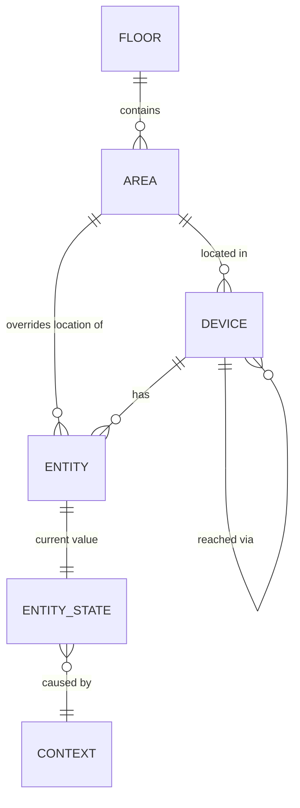

# Spec: entities, registry, and state

Status: **accepted for Phase 0** (M0.2). Changes go through a PR that updates this file, the
types in `crates/irori-types`, the generated `schemas/`, and the examples in `fixtures/types/`
together; CI fails if the last three disagree.

---

## 1. Purpose

This is the vocabulary every other part of Irori speaks: extensions report devices and
state in it, rules read and act on it, the recorder stores it, the API and UI show it, and AI
features generate against it. It has to be:

- **Typed.** A light's brightness is a number from 1 to 255, not "whatever string the
  extension sent". Rules can be checked before they run (ROADMAP D8).
- **Familiar.** Domain names and fields follow Home Assistant where that doesn't cost typing
  (D14), because people and LLMs already know them.
- **Strict at the edges.** Unknown fields and malformed ids are rejected with a message that
  says what's wrong, so mistakes surface when data enters, not three layers later.

## 2. The model at a glance

Two halves, deliberately kept apart:

| | **Registry** (§4) | **State** (§5) |
|---|---|---|
| What | What exists and what it can do | What it's doing right now |
| Types | `Floor`, `Area`, `Device`, `Entity` | `EntityState` |
| Changes | Rarely: pairing a device, renaming, moving rooms | Constantly: every sensor report |
| Stored | Registry tables; user edits in the config dir (M0.7) | In memory; history in the recorder |

Splitting them keeps every state update small, and lets rules be checked against the
registry ("does this light support color temperature?") without looking at live values.

## 3. Identifiers

All ids are case-sensitive strings. Every type validates on construction and when parsed,
and its JSON Schema carries the same rule.

| Type | Format | Example |
|---|---|---|
| Slug ids: `FloorId`, `AreaId`, `DeviceId`, `ProtocolId`, `UserId`, `RuleId`, `TokenId`, `AttributeKey` | `^[a-z0-9]+(_[a-z0-9]+)*$`, 1–64 chars: lowercase letters and digits in words joined by single `_` | `ground_floor` |
| `EntityId` | `<kind>.<object_id>`; `kind` is one of the kinds in §4.4, `object_id` is a slug | `binary_sensor.hallway_motion` |
| `ContextId` | ULID: 26 chars, uppercase Crockford base32, first char `0`–`7` | `01K5B2Q9A1B2C3D4E5F6G7H8J9` |
| `UniqueId` | Opaque, 1–255 chars, no control characters. Chosen by the protocol, unique within it | `0x00158d0001a2b3c4` |
| `Name` | 1–100 chars, no leading/trailing whitespace, no control characters. Any language | `Küche · Decke` |

Why these choices:

- **Slugs are strict** (no `-`, no uppercase, no `__`) so ids are safe in file names, URLs,
  expressions, and config keys without escaping, and there's exactly one spelling of each.
- **The entity kind lives in the id.** `light.hallway` can never be a switch, and anything
  holding just an id (a rule, a trace, a log line) knows the kind. The `.` separator matches
  Home Assistant.
- **ULIDs for contexts** sort by creation time, which makes "what caused what" chains easy to
  order. The core generates them from its injected clock (D10); types never read the clock.
- **`id` vs `unique_id`.** `unique_id` is the protocol's permanent handle (a Zigbee
  address). `id` is the user-facing name and may change. Pairing a device again or restarting
  maps back to the same entry through `(protocol, unique_id)`.

## 4. Registry

JSON field names are `snake_case`. Optional fields may be omitted, and Irori omits them when
writing.

### 4.1 Floor

| Field | Type | Required | Notes |
|---|---|---|---|
| `id` | `FloorId` | yes | |
| `name` | `Name` | yes | |
| `level` | integer −128…127 | yes | Sort order. `0` is the entrance level, negative is below ground |

### 4.2 Area

A room or zone.

| Field | Type | Required | Notes |
|---|---|---|---|
| `id` | `AreaId` | yes | |
| `name` | `Name` | yes | |
| `floor_id` | `FloorId` | no | |

### 4.3 Device

A physical or virtual thing a protocol talks to. It has one or more entities.

| Field | Type | Required | Notes |
|---|---|---|---|
| `id` | `DeviceId` | yes | Its **one** id, everywhere. Made once from `protocol` and `unique_id` — `esphome_00_11_22_33_44_55` — and never from a name, so it never changes (ROADMAP D36) |
| `protocol` | `ProtocolId` | yes | The protocol that provides it |
| `unique_id` | `UniqueId` | yes | Unique within `protocol` |
| `name` | `Name` | yes | Its one name: a person's, else what the protocol reports. Never two side by side |
| `description` | `Description` | no | What it's for, in a person's words |
| `manufacturer`, `model`, `sw_version`, `hw_version` | string | no | As reported; informational only |
| `area_id` | `AreaId` | no | |
| `suggested_area` | `Name` | no | The room the device says it's in; used only while no one has placed it ([config.md](config.md) §5) |
| `via_device_id` | `DeviceId` | no | The bridge or coordinator it's reached through |

### 4.4 Entity

One controllable or observable thing, e.g. a device's light, its illuminance sensor, and its
motion sensor are three entities.

| Field | Type | Required | Notes |
|---|---|---|---|
| `id` | `EntityId` | yes | Its kind must match `capabilities.kind`. `<kind>.<device id>_<name the protocol gave it>`, or the protocol's `suggested_object_id`: never a name a person chose, so no rename leaves an id that says something else |
| `protocol` | `ProtocolId` | yes | |
| `unique_id` | `UniqueId` | yes | Unique within `protocol`; survives renames of `id` |
| `name` | `Name` | yes | |
| `device_id` | `DeviceId` | no | Entities without a device are allowed (e.g. a computed value) |
| `area_id` | `AreaId` | no | **Overrides** the device's area. Effective area = `entity.area_id` ?? `device.area_id` |
| `capabilities` | object tagged by `kind` | yes | What it can do; see below |
| `entity_category` | `config` \| `diagnostic` | no | One of the device's settings (a motion sensor's timeout) or diagnostics (its signal strength) rather than what it's for. Pages list these after the device's other entities. Home Assistant's names; set by the protocol |

**Kinds:** `light`, `switch`, `sensor`, `binary_sensor`, `number`, `select`, `text`, `button`,
`event`, `cover`, `lock`, `fan`, `valve`, `siren`, `climate`, `water_heater`, `humidifier`,
`media_player`, `update`, `alarm_control_panel`, `date`, `time`, `datetime`, `vacuum`, `lawn_mower`.
**Next, in likely order:** `scene`, `device_tracker`. Home Assistant's `remote` isn't planned: neither ESPHome nor MQTT discovery
has one, so nothing could report it. Adding a kind is an
additive change: a file in `crates/irori-types/src/kinds/` with its capabilities, state, service
data and checks, and a new tag in `Capabilities`, `State` and `Service`.

Every kind has one **primary value** (`on`, a reading, a position…), a bool, number or text. It's
what automations compare (`on()`, `num()`, `text()`, a state trigger's `to`, [rules.md](rules.md)
§5.1), so the rules engine and the editor work with a new kind without code of their own.

**Capabilities by kind** (static facts; they don't change with state):

| Kind | Field | Type | Default | Meaning |
|---|---|---|---|---|
| `light` | `brightness` | bool | `false` | Dimmable |
| | `color_temp_kelvin` | `{ min, max }`, 1000–20000, `min ≤ max` | absent | Supports color temperature in this range |
| | `rgb` | bool | `false` | Supports RGB color |
| `switch` | `device_class` | `outlet` \| `switch` | absent | |
| `sensor` | `value_type` | `number` \| `text` | **required** | Rules are type-checked against it |
| | `device_class` | Home Assistant's sensor device classes, by the same names (`temperature`, `humidity`, `power`, `pm25`, `timestamp`, …; 61 in all, see the schema), except carbon dioxide, which is `co2`. HA's `enum` isn't a class here: a sensor reporting from a fixed list says so with `options` | absent | |
| | `unit` | string | absent | E.g. `°C`, `lx`, `%`, `W`, `kWh` |
| | `state_class` | `measurement` \| `total` \| `total_increasing` | absent | How values accumulate, for statistics |
| | `options` | list of up to 256 distinct, non-blank strings | absent | Only with `value_type: text`: every text it can report (HA's `enum` sensors). A reading outside it is refused, and rules comparing it with text it can never have are refused when saved |
| `binary_sensor` | `device_class` | Home Assistant's binary sensor device classes, by the same names (`motion`, `occupancy`, `presence`, `door`, `garage_door`, `window`, `opening`, `lock`, …; 29 in all, see the schema) | absent | Says what `on` means, as in Home Assistant: a `lock` that's on is **unlocked**, a `battery` that's on is low |
| `number` | `min`, `max` | finite numbers, `min ≤ max` | **required** | The range it takes. Values outside it are refused, reported or asked for |
| | `step` | finite number above 0 | **required** | The smallest change that means anything; a hint for pages, not a rule |
| | `unit` | string | absent | E.g. `s`, `°C`, `%` |
| | `device_class` | as a sensor's | absent | What it measures |
| | `mode` | `auto` \| `slider` \| `box` | `auto` | How a page offers it; `auto` is a slider for at most 256 steps, a box otherwise |
| `select` | `options` | 1–256 distinct, non-blank strings | **required** | Every choice it has. Anything else is refused, reported or asked for, and rules are checked against it like a text sensor's options |
| `text` | `min_length`, `max_length` | 0–255, `min ≤ max` | `0`, `255` | Characters, not bytes |
| | `pattern` | regular expression | absent | The device's; it checks it, pages show it |
| | `mode` | `text` \| `password` | `text` | A `password` is never shown by pages |
| `button` | `device_class` | `identify` \| `restart` \| `update` | absent | What pressing it does |
| `event` | `event_types` | 1–256 distinct, non-blank strings | **required** | Everything it can report happening, e.g. `single`, `double`, `hold` |
| | `device_class` | `button` \| `doorbell` \| `motion` | absent | |
| `cover` | `device_class` | `awning` \| `blind` \| `curtain` \| `damper` \| `door` \| `garage` \| `gate` \| `shade` \| `shutter` \| `window` | absent | |
| | `position`, `tilt`, `stop` | bool | `false` | Can go to a position, has slats that tilt, can be stopped while moving |
| `lock` | `open` | bool | `false` | Can open the door, not only unlock it |
| | `requires_code` | bool | `false` | Locking, unlocking and opening need its code |
| | `code_format` | regular expression | absent | The device's; pages show it |
| `alarm_control_panel` | `arm_modes` | list of `home` \| `away` \| `night` \| `vacation` \| `custom_bypass`, no repeats | `[]` | The ways it can be armed. One with none is disarmed and watched |
| | `trigger` | bool | `false` | Can be set off on purpose |
| | `code_format` | `number` \| `text` | absent | What its code looks like, when it takes one. Pages show a keypad for digits |
| | `code_arm_required`, `code_disarm_required` | bool | `false` | Arming, or disarming, needs the code. Only with a `code_format` |
| `vacuum` | `start`, `pause`, `stop`, `return_home`, `locate`, `clean_spot` | bool | `false` | What it can be told to do |
| | `fan_speeds` | list of strings, up to 32 | `[]` | Its fan speeds by its own names (`quiet`, `turbo`). Empty for one with no choice |
| `lawn_mower` | `start_mowing`, `pause`, `dock` | bool | `false` | What it can be told to do |
| `date`, `time`, `datetime` | none | | | A day, a time of day, or a moment that someone sets. Nothing to say about one beyond its kind |
| `valve` | `device_class` | `water` \| `gas` | absent | |
| | `position`, `stop` | bool | `false` | Opens part of the way; can be stopped |
| `siren` | `tones` | up to 256 distinct strings | `[]` | The tones it can sound |
| | `volume`, `duration` | bool | `false` | Can be told how loud; for how long |
| `climate` | `hvac_modes` | 1 or more of `off` \| `heat` \| `cool` \| `heat_cool` \| `auto` \| `dry` \| `fan_only` | **required** | The modes it can be put in |
| | `min_temp`, `max_temp` | °C, `min ≤ max` | **required** | The targets it takes |
| | `temp_step` | °C above 0 | **required** | How finely a target can be set |
| | `target_temperature` | bool | `false` | Takes one target |
| | `target_temperature_range` | bool | `false` | Takes a range: heats below `target_temp_low`, cools above `target_temp_high` |
| | `target_humidity` | `{ min, max }` in % | absent | Takes a target humidity in this range |
| | `fan_modes`, `swing_modes`, `preset_modes` | up to 256 distinct strings each | `[]` | E.g. `auto`/`low`/`high`; `off`/`vertical`; `eco`/`away`/`boost` |
| `water_heater` | `operation_modes` | 1 or more of `off` \| `eco` \| `electric` \| `gas` \| `heat_pump` \| `high_demand` \| `performance` | **required** | The modes it can be put in |
| | `min_temp`, `max_temp`, `temp_step` | °C, as a climate entity's | **required** | |
| | `target_temperature` | bool | `false` | Takes a target |
| | `on_off` | bool | `false` | Has its own on and off apart from its modes. While switched off its mode reads `off`, even if `off` isn't among its modes |
| `humidifier` | `device_class` | `humidifier` \| `dehumidifier` | absent | |
| | `humidity` | `{ min, max }` in %, within 0–100 | **required** | The targets it takes |
| | `modes` | up to 256 distinct strings | `[]` | E.g. `normal`, `eco`, `sleep` |
| `fan` | `speed_count` | integer | `0` | How many real speeds it has; 0 when its speed can't be set. Speeds go over the wire as percentages, as in Home Assistant |
| | `oscillate`, `direction` | bool | `false` | Can swing; can turn the other way |
| | `preset_modes` | up to 256 distinct strings | `[]` | Modes beyond its speed, e.g. `auto`, `sleep` |
| `media_player` | `device_class` | `tv` \| `speaker` \| `receiver` | absent | |
| | `volume`, `mute`, `seek`, `play_media`, `queue`, `turn_on`, `turn_off` | bool | `false` | Volume is 0–100. `seek` is a position in the current media. `play_media` plays a URL or another id. `queue` skips tracks. There is no toggle |
| `update` | `device_class` | `firmware` | absent | |
| | `install` | bool | `false` | Can be told to install. Without it, it only says an update exists |
| | `check` | bool | `false` | Can be told to look for a newer version now |

**Temperatures are °C**: in climate entities and water heaters (capabilities, state and
services alike), and in every `sensor` and `number` whose `device_class` is `temperature` or
`temperature_delta`. Protocols convert what a device says in °F or K on the way in, and a
number's value back on the way out; its range and step are converted too, and its `unit` reads
`°C`. Otherwise `num('sensor.outside') < num('climate.hall', 'target_temperature')` silently
compares °F with °C. A `temperature_delta` (a calibration offset) is a difference, so only its
scale changes. Pages show °C for now.

A converted entity's reports carry the attribute `native_unit` (`°F`, `K`): the unit its device
speaks (§5.4). Two things read it:

- **History.** Readings stored before Irori converted a sensor are in its device's unit. The
  first converted reading has the recorder convert those once (changes and summaries), so a
  chart doesn't jump at the upgrade. It remembers having done so.
- **Flows.** A flow that compares a number with a converted entity gets a warning on that
  node, naming the number: a `70` written when the sensor read °F now means 70 °C. Nothing
  is rewritten.

**Unlocking, opening and disarming let someone in.** Pages ask before sending them, in a window
that also takes the code a lock or an alarm panel needs. A code travels with its call
(`lock.unlock {code}`, `alarm_control_panel.alarm_disarm {code}`), is never shown in logs (its
`Debug` hides it), and is never kept. Arming is sent at once, unless the panel wants its code
for that too. A flow can't carry a code yet ([automations.md](automations.md) §B6.7), so it
arms and disarms only a panel that doesn't need one for it; the core refuses the others and
says why.

**Installing an update takes the device away for a while** and can't be undone. Pages ask before
sending `update.install`, in a window that says what version it is and is also where a version
is skipped. Rules may install; the editor says what that does when the call is written.

Device classes are closed lists, matching Home Assistant's: a protocol maps what it knows (with
`SensorClass::from_ha` and friends) and leaves the rest absent. New classes are additive.

### 4.5 Irori's own device

Irori is a device in its own home: `irori_hub`, from the built-in `irori` protocol, with the
sensors `sensor.irori_version` (text), `sensor.irori_uptime` (minutes), `sensor.irori_cpu`,
`sensor.irori_memory` and `sensor.irori_disk` (% in use, the disk being the data directory's), and
`sensor.irori_temperature` (°C) on a machine that says, such as a Raspberry Pi. They're read every
30 seconds, so an automation can watch them like any sensor. Unlike every other device it is never
held for "+ Add device": nobody has to be asked whether Irori may be in the home.

"Irori starts up" is not one of these entities. A value set at boot is already there when an
automation engine starts watching, so it can't be seen changing; engines keep a `startup`
trigger for it, and the flow editor offers it under Irori.

## 5. State

### 5.1 EntityState

| Field | Type | Required | Notes |
|---|---|---|---|
| `entity_id` | `EntityId` | yes | Its kind must match `state.kind` |
| `availability` | `available` \| `unavailable` | yes | Is the device reachable? |
| `state` | object tagged by `kind`, or `null` | yes, even when `null` | The typed value; `null` means **unknown** |
| `attributes` | map of `AttributeKey` → any JSON | no | Protocol extras; see §5.4 |
| `last_changed` | `Timestamp` | yes | `state` or `availability` changed |
| `last_updated` | `Timestamp` | yes | `state`, `availability`, or `attributes` changed |
| `last_reported` | `Timestamp` | yes | The protocol last reported anything about it, even an identical value |
| `context` | `Context` | yes | What caused the last change (§6) |

Timestamps are RFC 3339 with an offset, written in UTC (`2026-09-15T22:04:31.12Z`). Always
`last_changed ≤ last_updated`. `last_reported` is what tells a stale sensor (no reports for hours)
from a steady one (same value, reported every minute), so it only moves when the protocol says
something. It starts when the entity is registered: describing an entity **is** the protocol
telling Irori about it, and an entity that has never reported a value shows that as `state: null`.
So it's never empty. It can be earlier than the other two: when a protocol crashes, Irori marks its
entities unavailable without hearing from them, and the page can still say "offline, last heard
from 3 hours ago".

### 5.2 Unknown vs unavailable

These are different questions, so they're different fields:

| Situation | `availability` | `state` |
|---|---|---|
| Normal | `available` | the value |
| Device offline | `unavailable` | **the last known value**, kept |
| Never reported since startup | `available` | `null` |
| Offline and never reported | `unavailable` | `null` |

In Home Assistant both replace the value with a string (`"unavailable"`, `"unknown"`), so the
last value is lost and every numeric comparison must guard against strings. Keeping them
separate means the UI can show "21.5 °C (offline)", and the rules spec (M0.3) decides
explicitly how triggers and conditions treat unavailable entities.

### 5.3 State by kind

All are tagged with `kind`, e.g. `{ "kind": "light", "on": true, "brightness": 153 }`.

| Kind | Field | Type | Required | Notes |
|---|---|---|---|---|
| `light` | `on` | bool | yes | |
| | `brightness` | integer 1–255 | no | Only if dimmable. Kept while off: the level it returns to. `0` is invalid; off is `on: false` |
| | `color_mode` | `color_temp` \| `rgb` | no | Which color setting is active |
| | `color_temp_kelvin` | integer 1000–20000 | no | |
| | `rgb` | `[r, g, b]`, each 0–255 | no | |
| `switch` | `on` | bool | yes | |
| `sensor` | `value` | finite number or string | yes | Must match the entity's `value_type` (checked by the core, which has both) |
| `binary_sensor` | `on` | bool | yes | Meaning depends on `device_class`: motion detected, door open, … |
| `number` | `value` | finite number | yes | Within its `min`–`max` (checked by the core) |
| `select` | `option` | string | yes | One of its `options` (checked by the core) |
| `text` | `value` | string | yes | Within its `min_length`–`max_length` characters (checked by the core) |
| `event` | `event_type` | string | yes | What happened last: one of its `event_types` (checked by the core) |
| `cover` | `state` | `open` \| `opening` \| `closed` \| `closing` | yes | Its typed value, for rules (`text()`) |
| | `position`, `tilt` | integer 0 (closed) – 100 (open) | no | Only when it said it has them |
| `lock` | `state` | `locked` \| `unlocked` \| `locking` \| `unlocking` \| `jammed` \| `open` \| `opening` | yes | Its typed value, for rules |
| `vacuum` | `activity` | `cleaning` \| `docked` \| `idle` \| `paused` \| `returning` \| `error` | yes | Its typed value, for rules (`text()`). Home Assistant's `VacuumActivity` |
| | `fan_speed` | string | no | One of its `fan_speeds` (checked by the core) |
| `lawn_mower` | `activity` | `mowing` \| `docked` \| `paused` \| `returning` \| `error` | yes | Its typed value, for rules (`text()`). Home Assistant's `LawnMowerActivity` |
| `date` | `value` | a calendar day, `2026-10-14` | yes | Its typed value, as that text. A day that exists; no time zone, it's the day wherever the home is |
| `time` | `value` | a time of day to the second, `06:45:00` (`06:45` is read as the same) | yes | Its typed value, as that text. No date and no zone |
| `datetime` | `value` | `Timestamp` | yes | Its typed value, as its UTC text (`2026-10-14T06:45:00Z`). An instant: pages show and pick it on their own clock |
| `alarm_control_panel` | `state` | `disarmed` \| `armed_home` \| `armed_away` \| `armed_night` \| `armed_vacation` \| `armed_custom_bypass` \| `pending` \| `arming` \| `disarming` \| `triggered` | yes | Its typed value, for rules (`text()`). Home Assistant's states: `arming` counts down before it's armed, `pending` before it sounds |
| `valve` | `state` | `open` \| `opening` \| `closed` \| `closing` | yes | Its typed value, as a cover's |
| | `position` | integer 0–100 | no | When it opens part of the way |
| `siren` | `on` | bool | yes | Sounding or not |
| `climate` | `hvac_mode` | one of its `hvac_modes` | yes | Its typed value, for rules (`text()`) |
| | `hvac_action` | `off` \| `preheating` \| `heating` \| `cooling` \| `drying` \| `idle` \| `fan` \| `defrosting` | no | What it's doing now, when it says: set to heat but idle in a warm room |
| | `current_temperature` | °C | no | The room, as it measures it |
| | `target_temperature` | °C | no | With `target_temperature` |
| | `target_temp_low`, `target_temp_high` | °C | no | With `target_temperature_range` |
| | `current_humidity`, `target_humidity` | % 0–100 | no | |
| | `fan_mode`, `swing_mode`, `preset_mode` | string | no | One of its lists (checked by the core) |
| `water_heater` | `operation_mode` | one of its `operation_modes`, or `off` | yes | Its typed value |
| | `current_temperature` | °C | no | The water's |
| | `target_temperature` | °C | no | |
| `humidifier` | `on` | bool | yes | Its typed value |
| | `target_humidity`, `current_humidity` | % 0–100 | no | |
| | `mode` | string | no | One of its `modes` (checked by the core) |
| | `action` | `off` \| `humidifying` \| `drying` \| `idle` | no | What it's doing now |
| `fan` | `on` | bool | yes | Its typed value |
| | `percentage` | integer 0–100 | no | Its speed, when it has speeds. Kept while off |
| | `oscillating` | bool | no | When it can swing |
| | `direction` | `forward` \| `reverse` | no | When it can turn either way |
| | `preset_mode` | string | no | One of its `preset_modes`, when it's in one |
| `media_player` | `state` | `off` \| `idle` \| `playing` \| `paused` \| `buffering` \| `standby` | yes | Its typed value, for rules (`text()`). `standby` is only when the device says the screen is standing by |
| | `volume` | integer 0–100 | no | Only when it said volume can be set |
| | `muted` | bool | no | Only when it can be muted |
| | `title`, `artist`, `album`, `app`, `content_type` | string, 1–255 characters, not blank | no | What's playing, and which app |
| | `duration`, `position` | seconds, finite, 0 or more | no | `position` only when it can seek. A position more than a second past `duration` is refused |
| `update` | `available` | bool | yes | Its typed value, for rules (`on()`): a newer version is there to install, and nobody skipped it |
| | `installed_version`, `latest_version` | string | no | As the device writes them. They aren't compared as numbers: a device that says an update is available is believed, and otherwise two versions that differ are an update |
| | `in_progress` | bool | `false` | An install is running |
| | `progress` | number 0–100 | no | How far the install has got, from a device that says. Only while `in_progress` |
| | `title`, `release_summary`, `release_url` | string | no | What the software is called, a few words on the latest version, and where its notes are. The core cuts a device's text (these, the versions, `last_error`) to 255 characters, and keeps `release_url` only when it is an `http` or `https` address of at most 2048 characters: a page makes it a link |
| | `skipped_version` | string | no | The version someone passed over. **Set by the core**; a protocol's is dropped before the report is checked |
| | `last_error` | string | no | Why the last install didn't finish: the protocol's reason when it has one, otherwise the core's. Cleared when the next install is sent |

**Automations read the other values by name.** The typed value is what `on()`, `num()` and
`text()` read and what a state trigger watches. The rest of a state is readable too, as
*fields* ([rules.md](rules.md) §5.1): `num('cover.blind', 'position')`, or `field` on a trigger.
A field is one of the names in the table above, with its value as on/off, a number or text:

| Kind | Fields |
|---|---|
| `light` | `brightness`, `color_temp_kelvin`, `color_mode` |
| `fan` | `percentage`, `oscillating`, `direction`, `preset_mode` |
| `cover` | `position`, `tilt` |
| `valve` | `position` |
| `climate` | `hvac_action`, `current_temperature`, `current_humidity`, `target_temperature`, `target_temp_low`, `target_temp_high`, `target_humidity`, `fan_mode`, `swing_mode`, `preset_mode` |
| `humidifier` | `target_humidity`, `current_humidity`, `action`, `mode` |
| `water_heater` | `current_temperature`, `target_temperature` |
| `media_player` | `volume`, `muted`, `title`, `artist`, `album`, `app`, `content_type`, `duration`, `position` |
| `update` | `installed_version`, `latest_version`, `in_progress`, `progress` |
| `vacuum` | `fan_speed` |

An entity has the fields its capabilities allow (a light that can't dim has no `brightness`);
readings nothing announces ahead of time, like a thermostat's `current_temperature`, are listed
for every entity of the kind. Lists and objects (`rgb`) aren't fields. In code:
`Capabilities::fields()` and `State::field()`, each kind answering in its own file.

**Dates and times are text that sorts in time order.** Written the ISO 8601 way, an earlier
one is also the lesser text, so rules compare them as they would any text:
`text('time.wake_up') < '07:30:00'`, or a state trigger's `to: "2026-12-25"`.

**An `event`'s every report is something happening.** Two `double` presses of a remote in a row
are two changes: each moves `last_changed` and is a change for anything watching, even though the
value is the same. A report the protocol marks `replayed` ([protocols.md](protocols.md) §6.3), only
repeating what it last heard, sets the value and is not a change. Protocols keep every press
waiting for the core in order, rather than only the latest as for values.

**An `update` is partly the core's.** No device remembers that someone skipped a version, so
the core does: `update.skip` and `update.clear_skipped` are answered by the core and never reach
a protocol, the skipped version is kept across restarts, and it is forgotten when the device
offers a newer one. While the latest version is the skipped one, `available` is `false`, in
pages and in rules alike. The core also says when an install failed. One that leaves
`in_progress` on the version it started with failed, as did one that never started within two
minutes of being asked, or said nothing for ninety. And it sends a protocol **one install at a
time** ([protocols.md](protocols.md) §7.1): the rest wait their turn.

A `button` has **no state**: there is no `button` tag, and its `EntityState.state` is always
`null`. For a button that means "has no value", not "unknown" (§5.2): pressing it is something it
does, not something it is. Rules can't read or compare it (`on()`, a state trigger), only press it.

**Brightness is 1–255**, not a percentage: that's what Zigbee and Home Assistant use, so no
precision is lost converting. Services will accept `brightness_pct` for people (M0.3).

### 5.4 Attributes

A free-form map for protocol-specific extras (`linkquality`, `battery_voltage`, …). Keys are
slugs; values are any JSON. Rules may read them, but they're **not type-checked**, so
anything the core or rules rely on must become a typed field instead. Attributes are the
escape hatch, not the model.

One attribute has a meaning Irori reads: `native_unit`, on an entity whose temperature a
protocol converts to °C (§4.4). It's about how the device speaks, not what the entity is, which
is why it isn't a capability.

## 6. Context

Every state change and service call carries a context, so any change can be traced to its
cause ("the hallway light turned on because rule `hallway_motion_light` run X ran, because
the motion sensor reported at 22:04:12").

| Field | Type | Required | Notes |
|---|---|---|---|
| `id` | `ContextId` | yes | |
| `parent_id` | `ContextId` | no | The context that led to this one |
| `origin` | object tagged by `type` | yes | See below |

| `origin.type` | Fields | Meaning |
|---|---|---|
| `device` | `protocol` | Reported by a device, e.g. someone pressed a physical switch |
| `user` | `user_id` | A person, through the UI or CLI |
| `automation` | `extension`, `run_id` (ULID) | An installed automation engine's run. The engine (not the core) owns what a "rule" is. |
| `api` | `token_id` | An API client with an access token |
| `system` | — | Irori itself: restoring state at startup, reloading config |

## 7. Validation

Data is validated in layers. This spec covers the first two; the core adds the third.

1. **JSON Schema** (`schemas/*.schema.json`, draft 2020-12, generated by `cargo xtask schemas`).
   For editors, other languages, and LLM tooling. Covers shapes, enums, id patterns,
   ranges, unknown fields, and the id-kind ↔ tag match.
2. **Rust types** (`irori-types`, also compiled to wasm for the UI). Everything the schema
   checks, plus rules JSON Schema can't express:
   - `min ≤ max` for `color_temp_kelvin`
   - `last_changed ≤ last_updated`

   These examples live in `fixtures/` as `*.schema-allows.json`, so it's explicit which rules
   only Rust enforces.
3. **Against the registry** (the core): a device's `area_id` exists, a state's value matches
   the entity's capabilities (`brightness` only if dimmable, sensor `value` matches
   `value_type`), `unique_id` is unique per protocol, `via_device_id` has no cycles.

**Error messages are part of the contract.** They name the field or value and say what's
allowed, e.g. ``entity `light.hallway` is a light, but its state is for a switch``. The
golden examples in `fixtures/types/*/invalid/` pin the expected message for each case, so a
change that makes an error vaguer fails the tests.

**Unknown fields are rejected** everywhere. A typo (`"birghtness"`) fails loudly instead of
being silently ignored. Adding a field is therefore a coordinated change between producers and
consumers; API versioning is part of the API spec (M0.5).

## 8. Not in this spec (on purpose)

| Topic | Where it's decided |
|---|---|
| Services (`light.turn_on` and its parameters) | [Protocol contract](protocols.md) §7 (what protocol extensions receive); API and rules specs (how people and rules call them) |
| How automations treat `unavailable` and `null` state | Each engine decides. The first-party sequential engine fails closed ([rules.md](rules.md) §9). |
| Run and trace ids and formats | Trace spec (M0.4) |
| Registry and state over the API | API spec (M0.5) |
| How protocol extensions create and update entries | [Protocol contract](protocols.md) §5–§6 |
| How users rename entities or assign areas in files | Config spec (M0.7) |
| Renaming an entity `id` and rewriting rules that use it | Open question 1 |
| Hidden/disabled entities, icons | Later, when the UI needs them. (Entity categories are in §4.4) |
| Unit conversion and preferred units | Later; `unit` is informational for now |

## 9. Changes from the roadmap draft

ROADMAP M0.2 sketched a single `Entity` holding both registry and state fields, with
`Unavailable`/`Unknown` as state values. This spec changes that:

- **Registry and state are separate types** (§2), so state updates stay small and rules can
  be checked against capabilities alone.
- **Availability is its own field and unknown is `null`** (§5.2), so the last known value
  survives an outage.
- **Capabilities are explicit per kind** (§4.4), so "does it support X?" is a registry
  lookup, not a guess from which state fields happen to be present.
- **Context origin gained `system`**, for changes Irori makes itself.

Recorded as D20 in the ROADMAP decision log.

## 10. Open questions

1. **Entity renames.** When a user renames `light.hallway` to `light.hall_ceiling`, should the
   core rewrite rule files (they're the user's plain-text source of truth, D18), keep an alias,
   or refuse while rules reference it? Decide in M0.7 (config) with M0.3 (rules).
2. ~~**Text sensor values.**~~ Decided: a text sensor may list its `options` (§4.4), and rules are
   checked against them.
3. **Units.** Temperatures are decided: °C in the model, converted by protocols (§4.4). Other
   units are free-form strings today. Statistics use the number as reported. Before AI
   dashboards, decide whether to restrict units per `device_class` and normalize them too.
